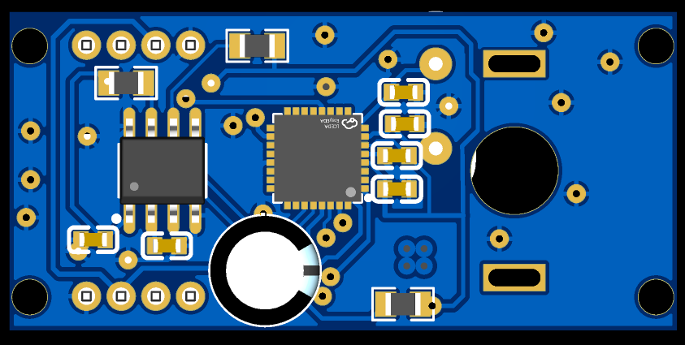
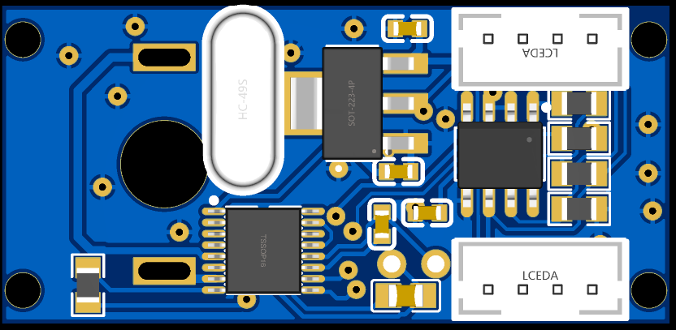

# 🦾 17-DOF Prosthetic Hand & Custom Smart Actuator (ORCA-Based)

An open-source, cost-effective dexterous robotic prosthesis built upon the **ETH Zurich ORCA Hand v1** architecture. This repository contains the custom hardware PCB designs, low-level embedded C/C++ actuator firmware, and high-level vision-based hand teleoperation controller.

---

## 🚀 System Overview & Key Engineering Highlights

To achieve high-DOF dexterity within a compact footprint and accessible cost structure, standard RC servos (MG995/MG996R) were gutted and retrofitted with custom-engineered electronics, transforming them into closed-loop smart actuators alongside a computer-vision teleoperation pipeline:

- **Custom Actuator Electronics (`Slave_QFN32`):** 
  - **MCU:** ATmega328PB-MU (QFN-32 package) running bare-metal/Arduino C/C++ control loops.
  - **Magnetic Position Feedback:** 12-bit contactless **AS5600** magnetic encoder over I2C ($0.087^\circ$ resolution) mounted directly to the output gear shaft.
  - **Motor Drive:** Dual H-Bridge driver (**DRV8833 / TB6612FNG**) with high-frequency PWM driving and current regulation.
  - **Communication Bus:** Multi-drop serial/I2C master-slave bus architecture (`master_unor3` $\leftrightarrow$ `Slave_QFN32`).
- **High-Level Hand Controller & Teleoperation (`DynamixelV2`):**
  - Python-based multi-actuator tendon kinematics controller (`Ver2Full.py`).
  - Real-time human hand pose estimation and retargeting using MediaPipe (`hand_landmarker.task`).

---

## 🛠️ Custom PCB Design & Hardware Bring-Up

The custom actuator PCBs were designed to fit directly inside the standard servo housing while separating high-current motor traces from sensitive magnetic encoder and communication lines.

| PCB Layout Design | Assembled Front View | Assembled Back View |
| :---: | :---: | :---: |
|  |  |  |

---

## 💻 Firmware & Control Architecture

### 1. Low-Level Closed-Loop PID Control (`Slave_QFN32.ino`)
Each smart actuator executes a local real-time position/compliance control loop using 12-bit feedback from the AS5600 magnetic sensor:

$$u(t) = K_p e(t) + K_i \int_{0}^{t} e(\tau)\,d\tau + K_d \frac{de(t)}{dt}$$

Where $e(t) = \theta_{\text{target}} - \theta_{\text{AS5600}}$ represents the joint angular error, and $u(t)$ drives the H-bridge PWM duty cycle and direction pins with deadband compensation and stall protection.

### 2. Tendon Kinematics & Vision Retargeting (`Ver2Full.py`)
3D hand landmarks captured via `hand_landmarker.task` are mapped from joint space to actuator tendon excursion lengths:

$$\Delta L_i = r_i \cdot (\theta_i - \theta_{i,0})$$

---

## 📂 Repository Structure

- **[`firmware/firmwareactuator_firmware/`](ORCA-Smart-Actuator-Prosthesis/firmware/firmwareactuator_firmware/)**
  - [`Slave_QFN32/Slave_QFN32.ino`](ORCA-Smart-Actuator-Prosthesis/firmware/firmwareactuator_firmware/Slave_QFN32/Slave_QFN32.ino) — Embedded C/C++ firmware for the QFN-32 ATmega328PB smart servo controller (AS5600 feedback + PID loop).
  - [`master_unor3/master_unor3.ino`](ORCA-Smart-Actuator-Prosthesis/firmware/firmwareactuator_firmware/master_unor3/master_unor3.ino) — Master bus bridge firmware for multi-actuator command coordination.
- **[`firmware/firmwarehand_controller/DynamixelV2/`](ORCA-Smart-Actuator-Prosthesis/firmware/firmwarehand_controller/DynamixelV2/)**
  - [`Ver2Full.py`](ORCA-Smart-Actuator-Prosthesis/firmware/firmwarehand_controller/DynamixelV2/Ver2Full.py) — Full 17-DOF ORCA Hand kinematic control & MediaPipe teleoperation pipeline.
  - [`dryrun.py`](ORCA-Smart-Actuator-Prosthesis/firmware/firmwarehand_controller/DynamixelV2/dryrun.py) — Actuator bus diagnostics and trajectory dry-run script.
- **[`docs/`](ORCA-Smart-Actuator-Prosthesis/docs/)** — PCB layouts and hardware bring-up photographs.

---

## 👤 Author
**Thanadon Poonsakhu (Kong)**  
Robotics and Automation Engineering Student @ FIBO, KMUTT  
Focus: Full-Stack Hardware, Custom PCB Design, Embedded C/C++, and Dexterous Manipulation
