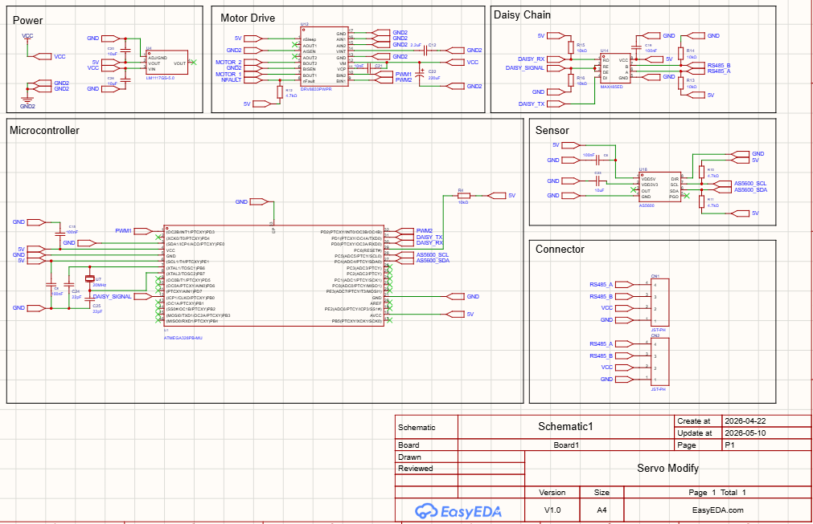
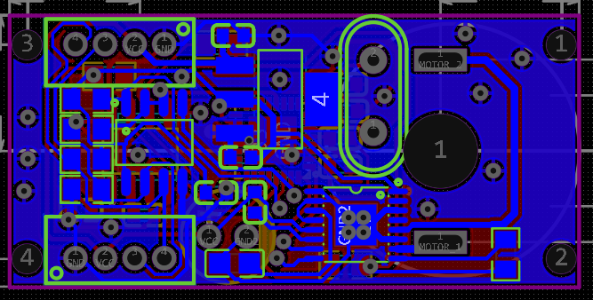
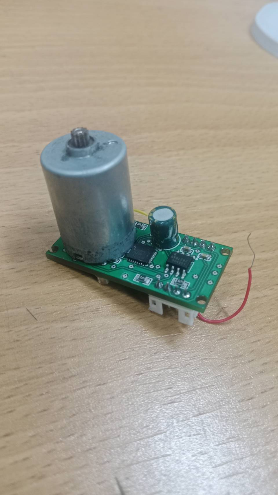

# 🦾 17-DOF Prosthetic Hand & Custom Smart Actuator (ORCA-Based)

An open-source, cost-effective dexterous robotic prosthesis built upon the **ETH Zurich ORCA Hand v1** architecture. This repository features custom PCB design, low-level embedded C/C++ actuator firmware, and computer-vision teleoperation pipelines.

---

## 🚀 System Overview & Key Engineering Highlights

To achieve high-DOF dexterity within a compact footprint and accessible cost structure, standard RC servos were retrofitted with custom-engineered electronics, transforming them into closed-loop smart actuators:

- **Custom Actuator Electronics (`Slave_QFN32`):** 
  - **MCU:** ATmega328PB-MU (QFN-32 package) running bare-metal/Arduino C/C++ control loops.
  - **Magnetic Position Feedback:** 12-bit contactless **AS5600** magnetic encoder over I2C mounted directly to the output gear shaft.
  - **Motor Drive:** Dual H-Bridge driver (**DRV8833**) with high-frequency PWM driving.
  - **Communication Bus:** Multi-drop serial communication bus architecture.

---

## 🛠️ Hardware Design, Layout & Real-World Bring-Up

The hardware pipeline spans from schematic capture and PCB layout design to physical assembly and motor integration.

| Schematic Design | PCB Layout | Real-World Assembled Hardware |
| :---: | :---: | :---: |
| [cite: 10] | [cite: 8] | [cite: 9] |

- **Schematic Capture:** Modular hierarchical design separating power regulation, MCU core, magnetic encoder, and motor driver stages.
- **PCB Layout:** Compact 2-layer design optimizing power traces and minimizing noise for magnetic sensors.
- **Physical Bring-Up:** Fully integrated custom PCB soldered and mounted directly onto the actuator gearbox, validated with closed-loop position tracking.

---

## 💻 Firmware & Control Architecture

### Low-Level Closed-Loop PID Control (`Slave_QFN32.ino`)
Each smart actuator executes a local real-time position feedback control loop using 12-bit absolute data from the AS5600 magnetic sensor:

$$u(t) = K_p e(t) + K_i \int_{0}^{t} e(\tau)\,d\tau + K_d \frac{de(t)}{dt}$$

Where $e(t) = \theta_{\text{target}} - \theta_{\text{AS5600}}$ represents the joint angular error, driving the H-bridge PWM duty cycle.

---

## 📂 Repository Structure

- **[`firmware/firmwareactuator_firmware/`](ORCA-Smart-Actuator-Prosthesis/firmware/firmwareactuator_firmware/)**
  - [`Slave_QFN32/Slave_QFN32.ino`](ORCA-Smart-Actuator-Prosthesis/firmware/firmwareactuator_firmware/Slave_QFN32/Slave_QFN32.ino) — Embedded C/C++ firmware for the QFN-32 ATmega328PB smart servo controller.
- **[`docs/`](ORCA-Smart-Actuator-Prosthesis/docs/)** — Hardware schematics, PCB layouts, and real-world hardware validation photos.

---

## 👤 Author
**Thanadon Poonsakhu (gong)**  
Robotics and Automation Engineering Student @ FIBO, KMUTT  
Focus: Full-Stack Hardware, Custom PCB Design, Embedded C/C++, and Dexterous Manipulation
